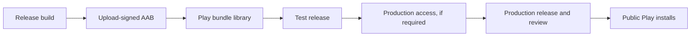

# Sugarfall's Google Play release pipeline

11 November 2026. The current candidate is **Sugarfall 0.8.0-rc7**, version code **48**, package **`com.sungati.sugarfall`**. The owner reports that the bundle is in Internal testing, that the native symbols uploaded successfully, and that version 48 was sent for review. Check the track listed for that submission in Play Console. [RC7 build record](ANDROID_SUGARFALL_v0.8.0-rc7.md)

## What to do with version 48 now

In **Test and release → Latest releases and bundles**, find version 48 under **Latest releases** and read the **Track** column. Use **Publishing overview** to check whether its changes are in review, ready to publish, or already published. [Release tracking](https://support.google.com/googleplay/android-developer/answer/9859348?hl=en) · [Publishing overview](https://support.google.com/googleplay/android-developer/answer/9859654?hl=en)

| What Console shows | What to do |
| --- | --- |
| Version 48 is already **in review on Closed testing** | Let that submission finish. If approved changes appear under **Changes ready to publish**, choose **Publish changes**. |
| Version 48 is listed **only under Internal testing** | When Console lets you edit the closed track, open **Closed testing → Manage track → Releases**. Create or edit the closed release and choose **Add from library → 48**. |
| Console says **version code 48 has already been used** on a second file upload | Select the existing bundle through **Add from library**. This creates a closed release using the uploaded artifact. |
| Console gives a specific error when adding 48 **from the library**, or the game needs a fix | Read that error first. If a replacement build is required, use the next unused higher version code, such as 49 if available. Keep the same app package and upload identity. |

An Android **build** is the AAB file. A Play **release** is a Console record that assigns an uploaded bundle to a **track**, which controls who can install it. Version 48 can be selected from the app's bundle library without uploading the file a second time. A changed binary needs a higher unused version code. [Play release setup](https://support.google.com/googleplay/android-developer/answer/9859348?hl=en) · [Android versioning](https://developer.android.com/studio/publish/versioning)

The closed-test opt-in link appears after publication. An internal release under review does not activate a closed track. If the closed release is still under review, check its status in **Publishing overview** and return to the closed track's **Testers** tab when the release is available. [Testing and opt-in links](https://support.google.com/googleplay/android-developer/answer/9845334?hl=en)

## 1. Create the app and complete the account setup

Create a Play Console developer account, finish the verification tasks on the Dashboard, and create the game record. Record the permanent package ID, which for Sugarfall is `com.sungati.sugarfall`. The app's public title can change independently of the package. The package in the exported bundle must match the Console record. Account and device verification steps depend on account type and what Console requests. [Create and set up an app](https://support.google.com/googleplay/android-developer/answer/9859152?hl=en) · [Device verification](https://support.google.com/googleplay/android-developer/answer/14316361?hl=en)

Prepare the store listing with the title, descriptions, icon, feature graphic, gameplay screenshots and support contact. Choose the intended countries and the free or paid app settings. Complete **App content** using the actual build and SDK behavior. That includes the privacy policy, Data safety, ads, target audience, content rating, reviewer access if gated, and applicable permissions or declarations. Closed testing already requires the relevant setup and Data safety. The internal-only exemption applies while distribution is exclusively internal. [Store assets](https://support.google.com/googleplay/android-developer/answer/9866151?hl=en) · [App content](https://support.google.com/googleplay/android-developer/answer/9859455?hl=en) · [Data safety](https://support.google.com/googleplay/android-developer/answer/10787469?hl=en)

For Sugarfall, check ad consent, rewarded ads and purchase configuration against the public build. A package that contains an ads or billing SDK can still have external configuration and device acceptance work outstanding. [Sugarfall release queue](GOOGLE_PLAY_READINESS.md)

## 2. Export, sign and verify the release build

| Term | What it means for Sugarfall |
| --- | --- |
| Package ID | Android's app identity. The Play build uses `com.sungati.sugarfall`. The Drive preview uses a separate package and installs separately. |
| Version name and version code | The display version is `0.8.0-rc7`. The integer code is `48`. Android and Play use the code to order builds. |
| Debug build | An Android build for development that can enable debugging and usually uses a development signing key. |
| Release build | The export configured for distribution. It can be tested on any Play testing track before production. Debug symbols are a separate artifact. |
| APK | An installable Android package. Sugarfall's signed APK is useful for direct device checks. |
| AAB | The publishing bundle. Play uses it to generate the APKs it will deliver for a device. Upload the signed AAB to the test or production release. |

[App bundles](https://developer.android.com/guide/app-bundle) · [Android versioning](https://developer.android.com/studio/publish/versioning)

**Signing** adds a cryptographic signature that identifies the signer and lets Android or Play verify the signed bytes. Editing the file after signing invalidates that signature. Android checks the package and signing identity when installing an update. The private key lives in a protected keystore. Keep its backup and password secure. A public certificate fingerprint identifies the key, while an AAB's file hash identifies that exact file. [Android app signing](https://developer.android.com/studio/publish/app-signing) · [Sugarfall signing record](RELEASE_SIGNING.md)

With **Play App Signing**, you sign the upload bundle using the **upload key**. Google verifies the upload and signs the APKs delivered to users with the **app signing key**. Check the certificate roles in **App integrity**. An APK signed locally with a different certificate may install independently on a clean phone, but Android rejects an in-place update over a Play install signed with an incompatible key. Run update tests through the actual Play track. [Play App Signing](https://developer.android.com/studio/publish/app-signing#app-signing-google-play)

Sugarfall's [Windows build instructions](ANDROID_RELEASE_BUILD.md) export, sign and verify the AAB and APK. Before each upload, verify the package, version code, signing certificate, native libraries, SDK level, and artifacts you will actually distribute. As checked on 11 November 2026, new and updated ordinary phone apps need target API 36 or higher. RC7 targets 36 and sets its installation floor to API 24. Its ARM64 files passed static 16 KB alignment checks. A phone or emulator test checks runtime behavior separately. [Target API requirements](https://developer.android.com/google/play/requirements/target-sdk) · [16 KB page sizes](https://developer.android.com/guide/practices/page-sizes)

## 3. Retain the files that make crash reports readable

| File | What it decodes | What Sugarfall has for version 48 |
| --- | --- | --- |
| Native debug symbols ZIP | Native addresses inside C or C++ libraries. `SYMBOL_TABLE` adds function names. `FULL` can add source files and line numbers. Match the symbols to the actual library Build IDs. | The [27.4 MB ZIP](../builds/Sugarfall-48-native-symbols.zip) matches both ARM64 libraries and contains their function names. The owner confirmed the upload. |
| R8 or ProGuard `mapping.txt` | Renamed or transformed Java and Kotlin code from the specific build. Android's R8 workflow generates and bundles this mapping with the AAB. | R8 was off for RC7, so the mapping field can stay empty. |

These files help diagnose crashes and ANRs, where the app stops responding. For manual attachment, select the exact bundle in **Latest releases and bundles → Downloads → Assets** and use the appropriate upload field. Keep the signed AAB, its version record, the matching symbols and any mapping with each release. If a later build changes native libraries, verify its Build IDs before reusing symbols. [Native symbols](https://developer.android.com/build/include-native-symbols) · [R8 mapping](https://developer.android.com/topic/performance/app-optimization/troubleshoot-the-optimization) · [Play upload instructions](https://support.google.com/googleplay/android-developer/answer/9848633?hl=en)

## 4. Test the game on the right track

| Stage | Who receives it | What to verify |
| --- | --- | --- |
| Local APK | People who install the APK directly | Launch, touch controls, audio, layout, gameplay and saves on real devices. |
| Internal testing | An invited group, up to 100 testers | A fast Play-delivered install and update check, including real device behavior. This stage is optional. |
| Closed testing | Selected accounts or Google Groups | The target audience can install through Play, play the game and give feedback. For eligible newer personal accounts, this is the production-access test. |
| Open testing | Anyone eligible who opts in | Wider feedback when the game and listing are ready for public visibility. This stage is optional and availability depends on production access. |
| Production | Eligible Play users in selected countries | Public installation and support, followed by monitoring and updates. |

[Testing tracks](https://support.google.com/googleplay/android-developer/answer/9845334?hl=en) · [Production access requirements](https://support.google.com/googleplay/android-developer/answer/14151465?hl=en)

For a closed test, choose the tester countries and add the Google accounts or group on the closed track's **Testers** tab. Add your feedback contact, save the configuration, select the bundle under **Releases**, and submit the release. Once published, copy the opt-in link from that same **Testers** tab. Testers open it with their invited Google account, join, then install from Play. Anyone enrolled in Internal for Sugarfall must leave Internal before joining Closed. [Closed-test setup](https://support.google.com/googleplay/android-developer/answer/9845334?hl=en) · [Country settings](https://support.google.com/googleplay/android-developer/answer/7550024?hl=en)

Run a fresh install and a Play-delivered update. Check onboarding, gameplay, purchases or rewards where configured, saving, and background and resume on a few phones. Review any [pre-launch report](https://support.google.com/googleplay/android-developer/answer/9842757?hl=en) for automated crash, compatibility, and accessibility findings. Collect tester feedback and record what you fixed. [Sugarfall phone test plan](AREA_PLAYTEST.md)

## 5. Apply for production access, then publish

For personal accounts created after 13 November 2023 that are subject to the requirement, Google calls for **at least 12 testers continuously opted in to Closed testing for at least 14 days**. Check progress on the Dashboard. When eligible, choose **Apply for production access** and describe how testers used the game, their feedback, and what you changed. Approval for access unlocks production submission. The production release then goes through its own review. [Production access requirements](https://support.google.com/googleplay/android-developer/answer/14151465?hl=en)

In **Production**, create a release and select the already tested bundle from the library, or use a newer verified build if fixes were needed. Confirm countries, listing, declarations, version and release notes. Submit the release and follow **Publishing overview** until it is approved and available. A first production release goes live for eligible users in the countries you selected. Later updates can use a percentage rollout and expand after you review stability. [Release and publication](https://support.google.com/googleplay/android-developer/answer/9859348?hl=en) · [Staged updates](https://support.google.com/googleplay/android-developer/answer/6346149?hl=en)

After publication, confirm the public Play page and install from it on an eligible device. Watch Android vitals, reviews and support reports. For each fix, keep the app package and signing identities, increment the version code, test the new AAB, and attach its matching diagnostics before rolling it out. [Android vitals](https://support.google.com/googleplay/android-developer/answer/9844486?hl=en)
